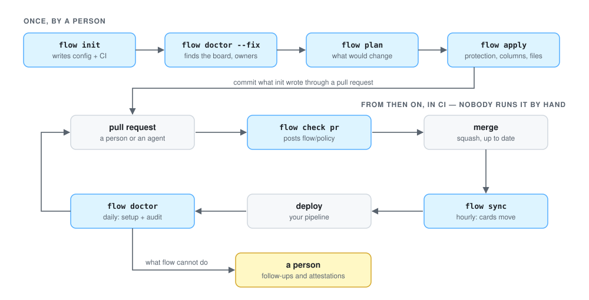
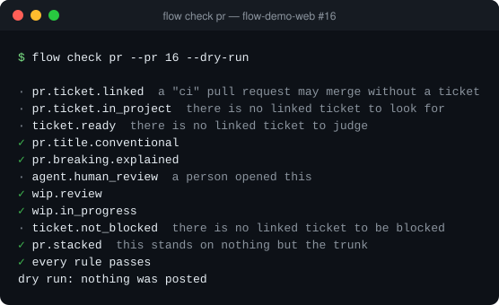

# flow — lean trunk-based delivery, made provably true

flow makes a lean trunk-based workflow true, and keeps checking that it stays
true, across the places your team already works: a forge (GitHub, GitLab,
Gitea/Forgejo) and a tracker (GitHub Projects, Jira, Linear).

It does three things, and after setup nobody runs it by hand:



- **Sets up** — `flow init`, `flow plan`, `flow apply`: branch protection,
  required checks, merge settings, board columns and labels, the CI that runs
  flow. Whatever the provider will not let flow do becomes a ticket for the
  person who can.
- **Gates** — `flow check pr` posts `flow/policy` on every pull request:
  linked to a ready ticket, conventional title, human review of agent work,
  WIP limits. Each rule warns or blocks as the team chooses, and says
  [why you are seeing it](docs/rules.md).
  <br/>
- **Verifies** — `flow doctor` (daily, in CI) checks that the setup still
  holds and audits what actually happened: was every merge gated, linked,
  built, deployed in time; is the board telling the truth. `flow sync` keeps
  the board's cards moving between runs.

```sh
go install github.com/17twenty/flow@latest
flow init        # writes .flow.yaml, the CI workflow and templates
flow doctor --fix   # finds what it can (the board, owners) and asks for the rest
flow plan && flow apply
```

Commit what `init` wrote through a pull request; from then on the workflow
runs flow on every pull request, hourly, and once a day.
[flow-demo-web](https://github.com/17twenty/flow-demo-web) is a repository set
up exactly that way, from empty.

## Documents

| | |
|---|---|
| [`docs/how-it-works.md`](docs/how-it-works.md) | The loop, a ticket's way across the board, who does what — and real output |
| [`docs/rules.md`](docs/rules.md) | Why am I seeing this? Every gate rule, why, and how to resolve it |
| [`docs/cookbook.md`](docs/cookbook.md) | The steps a person does by hand, per forge and tracker — and answering a follow-up flow filed |
| [`docs/delivery-board.md`](docs/delivery-board.md) | The delivery-board proposal flow was built from, verified line by line against what it does |
| [`docs/multi-repo.md`](docs/multi-repo.md) | Two repositories sharing one board |
| [`docs/design/`](docs/design/) | The design record: one spec per area, each ending in the decisions that shaped it. The code is tested against them |
| [`skills/flow/SKILL.md`](skills/flow/SKILL.md) | How an agent works a ticket to a reviewed pull request |
| [`CONTRIBUTING.md`](CONTRIBUTING.md) | Building, testing and changing flow |

## Working it with an agent

[`skills/flow/SKILL.md`](skills/flow/SKILL.md) is a skill for Claude-compatible
harnesses: verify the repository, take a ticket that meets the Definition of
Ready, commit messages the gate will accept, open a pull request that links its
ticket, and then wait for a person — because `agent.human_review` is not a
check an agent may clear for itself. Copy it where your client looks for
skills:

```sh
mkdir -p .claude/skills/flow && curl -fsSLo .claude/skills/flow/SKILL.md \
  https://raw.githubusercontent.com/17twenty/flow/main/skills/flow/SKILL.md
```

It names no repository of its own: every rule it follows is read out of the
`.flow.yaml` in front of it.

## Demo — flow runs on flow

This repository is flow's own live demo. The workflow below is not a diagram of
what flow could do: it is the one flow enforces here, on itself, every day.

| | |
|---|---|
| Board | <https://github.com/users/17twenty/projects/2> |
| Health | [#92 `flow health: 17twenty/flow`](https://github.com/17twenty/flow/issues/92) — rewritten in place by the daily run, carrying its own 30-day log |
| Agent pull requests | [`is:pr label:agent`](https://github.com/17twenty/flow/pulls?q=is%3Apr+label%3Aagent) — opened by `flow-bot-gh`, approved by `@17twenty`, merged on a green `flow/policy` |
| The gate | [`.github/workflows/flow.yml`](.github/workflows/flow.yml) — builds flow from the pull request's own checkout and judges it with that |

v1.0.0 is tagged after fourteen consecutive green daily runs. The count is kept
in the [health issue](https://github.com/17twenty/flow/issues/92), which the
daily run rewrites each morning with what it found and why — that is where to
read it, rather than a number here that somebody has to remember to change.

What the audit reads, against the expectations of
[spec 17 §7](docs/design/17-dogfood.md):

| Check | Expected |
|---|---|
| `live.prs.gated` | every merge carried `flow/policy` |
| `live.prs.linked` | every merge named a ticket |
| `live.prs.reviewed` | a person approved every agent pull request |
| `live.trunk.built` | every merge ran the checks the trunk requires |
| `live.deploys.lag` | shipped within 2h |
| `live.transitions.flow` | flow made the moves it owns, `pr_merged` and `issue_closed` among them |
| `live.tickets.review_has_pr` | nothing waits for a review of nothing |
| `live.tickets.ready_dor` | everything Ready meets the Definition of Ready |
