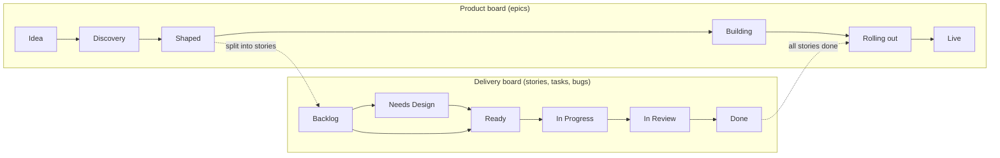
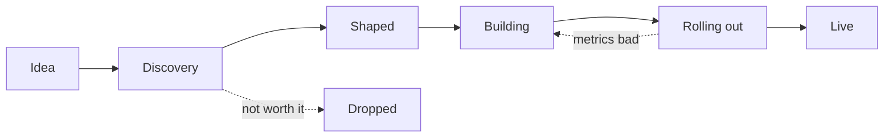
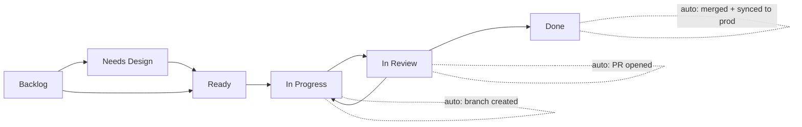
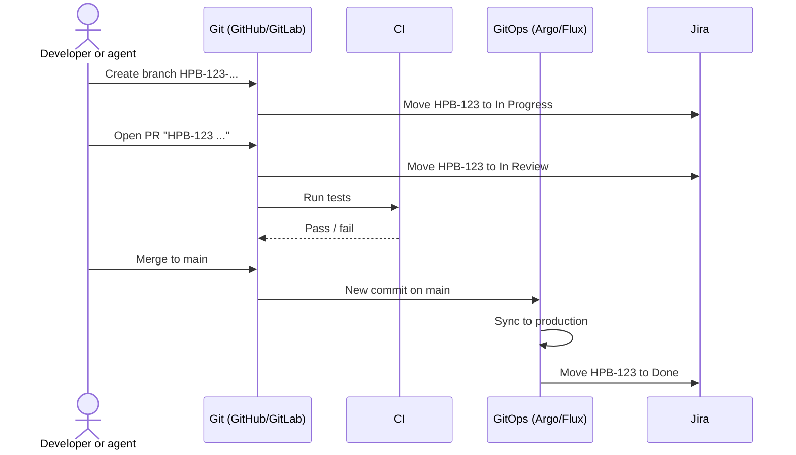
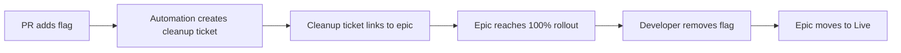

# Lean Kanban Workflow (Proposal)

Status: Draft for discussion
Replaces: [Jira Workflow (draft)](https://nexgencloud.atlassian.net/wiki/spaces/PD/pages/601030677/Jira+Workflow+draft)

---

## 1. Purpose

This document gives a simple Jira workflow for teams that:

- Use GitOps and trunk-based development.
- Deploy all merged code to production.
- Use feature flags to hide work that is not ready for users.
- Use AI agents to write code.
- Make developers responsible for testing their own code.

---

## 2. Principles

1. **Jira tracks work. Git tracks deployment. Flags track release.**
2. A deploy and a release are different events. A deploy puts code in production. A release makes a feature visible to users.
3. Environments are not workflow statuses. The pipeline knows where code runs. Jira does not need to know.
4. Git events move tickets. People do not drag cards between columns.
5. The "Ready" gate is the most important control. Put effort there.
6. There are no handoffs between roles. The author owns the ticket from start to finish.

---

## 3. Overview: Two Boards

We use two boards at two levels.

| Board | Level | Question it answers |
|---|---|---|
| Product board | Epic (feature) | What do we build, and is it live for users? |
| Delivery board | Story, task, bug | What code are we writing now? |

---

## 4. Board 1: Product Board (Epics)

### 4.1 Flow

### 4.2 Columns

| Column | Meaning | Exit rule |
|---|---|---|
| Idea | A problem or an opportunity. No work starts yet. | Product owner agrees to investigate. |
| Discovery | Team does research, talks to users, and writes the functional requirements (FR). | FR is written and agreed. |
| Shaped | FR, high-level design (HLD) and UX design are complete. Team splits the epic into stories. | Stories exist on the delivery board. Feature flag name is set. |
| Building | Stories are in progress on the delivery board. Code goes to production behind the flag. | All stories are Done. |
| Rolling out | Flag is on for some users (internal, beta, percentage). Team monitors metrics and errors. | Flag is on for 100% of users and metrics are acceptable. |
| Live | Flag is removed from the code. | All flag cleanup tickets are Done. |
| Dropped | Team decided not to continue. | None. |

### 4.3 Rules

- An epic is **not** Live until the flag is removed from the code.
- The product owner decides when to turn a flag on. This is the release decision.
- Discovery and shaping happen here, not on the delivery board.

---

## 5. Board 2: Delivery Board (Stories, Tasks, Bugs)

### 5.1 Flow

### 5.2 Columns

| Column | Meaning | Moved by | WIP limit |
|---|---|---|---|
| Backlog | Work that is not ready. | Person | None |
| Needs Design | Work that needs UX input. Optional. Skip it if design was complete in shaping. | Person | None |
| Ready | Work with clear acceptance criteria. A developer or an agent can start it. | Person (the gate) | None |
| In Progress | A branch exists for this ticket. | Automation | 2 per person |
| In Review | A PR is open. CI runs. | Automation | 2 × number of reviewers |
| Done | Code is merged to main and synced to production. | Automation | None |

### 5.3 Definition of Ready

A ticket can move to Ready only when:

- [ ] It has acceptance criteria that you can write as tests.
- [ ] It links to its epic.
- [ ] It states the feature flag name, if the change is visible to users.
- [ ] Design is attached, if the change has a UI.
- [ ] It is small. One person or one agent can finish it in 1–2 days.

### 5.4 Definition of Done

A ticket is Done only when:

- [ ] The author wrote tests for the change.
- [ ] CI passes.
- [ ] One person reviewed and approved the PR.
- [ ] The PR is merged to main.
- [ ] GitOps synced the change to production.
- [ ] The change is behind a flag, if it is not ready for users.

### 5.5 Rules

- Use one workflow for stories, tasks and bugs.
- Do not use sub-tasks. Split large work into small stories.
- Do not use "Story Bugs". A defect found before Done is part of the same ticket. A defect found after Done is a new bug.
- Do not use fix versions or release windows. Each merge is a release candidate.
- Do not use sprints. The board shows all work in the filter.

---

## 6. Automation: Git Moves the Tickets

Put the ticket key (for example `HPB-123`) in the branch name and the PR title.

| Git event | Jira transition |
|---|---|
| Branch created with ticket key | Ready → In Progress |
| PR opened | In Progress → In Review |
| PR changes requested | In Review → In Progress |
| PR merged and production sync succeeds | In Review → Done |

If the production sync fails, the ticket stays in In Review. The author must fix it.

---

## 7. Blocked Work

- Do not use a Blocked column.
- Use the Jira **flag** on the card.
- Add a comment. The comment must state:
  1. Why the work is blocked.
  2. What will unblock it.
  3. Who monitors it.

The card stays in its column. This keeps the flow visible.

---

## 8. Urgent Work

- Use an **Expedite** swimlane at the top of the delivery board.
- Use it for production incidents and urgent bugs only.
- Expedite work ignores WIP limits.
- Limit: 1 expedite item at a time per team.

---

## 9. Feature Flags

Rules:

- Each flag has one owner and one epic.
- When a PR adds a flag, automation creates a "Remove flag X" ticket.
- An epic cannot move to Live while a cleanup ticket is open.
- Review open flags each month. Remove flags that are older than 90 days, or explain why they stay.

---

## 10. AI Agents

- Agents take work only from **Ready**.
- Mark agent work with the label `agent`, or assign it to an agent user.
- A person must review each agent PR. The reviewer owns the merge.
- The WIP limit on In Review is important. Agents create PRs faster than people review them. When In Review is full, people review. They do not start new work.
- Track two numbers for agent work: throughput and rework rate (PRs sent back to In Progress).

---

## 11. Testing

- The author writes and runs tests. There is no QA handoff column.
- CI is the quality gate. A PR cannot merge if CI fails.
- QA engineers (if the team has them) do this work:
  - Build and maintain test tools, e2e suites and contract tests.
  - Do exploratory testing on flagged features in production or staging.
  - Help authors write better tests.

---

## 12. Change Management

GitOps gives a full change record:

| Evidence | Source |
|---|---|
| What changed | PR diff |
| Who approved it | PR approval |
| Proof it was tested | CI run |
| When it went to production | Argo/Flux sync history |
| Link to the requirement | Ticket key in branch and PR |

**Action:** Confirm with the owner of the company change management policy that this record is sufficient evidence. Do this before rollout, so that manual sign-off steps are not added later.

---

## 13. Comparison with the Current Draft

| Topic | Current draft | This proposal |
|---|---|---|
| Delivery statuses | 15+ | 6 |
| Environments in workflow | Dev, Staging, Prod statuses | None (pipeline handles them) |
| Testing | QA handoff on Dev and on Staging | Author tests in PR, CI enforces |
| Release | Release window, dev lead moves to Done | Every merge deploys; flags control release |
| Ticket movement | Manual, with reassignment between roles | Automatic, from Git events |
| Blocked | Column | Flag on card |
| Sprints | Required to show on board | Not used |
| Sub-tasks, Story Bugs | Used | Not used |
| Discovery and design | Not covered | Product board (epic level) |

---

## 14. Next Steps

1. Agree the two boards with engineering and product leads.
2. Confirm change management evidence with the policy owner.
3. Set up Jira ↔ Git integration and automation rules.
4. Set up flag cleanup automation.
5. Pilot with one team for 4 weeks.
6. Review cycle time, review queue size and flag count. Adjust WIP limits.
