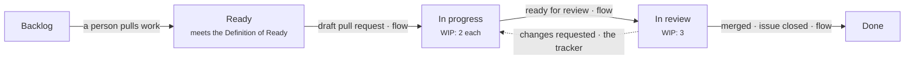
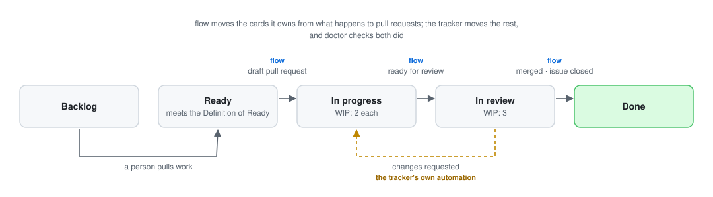
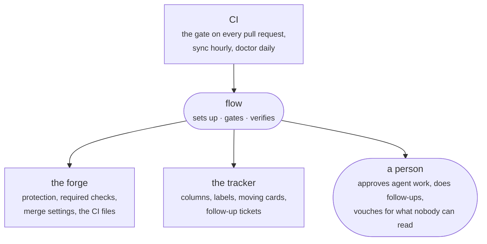
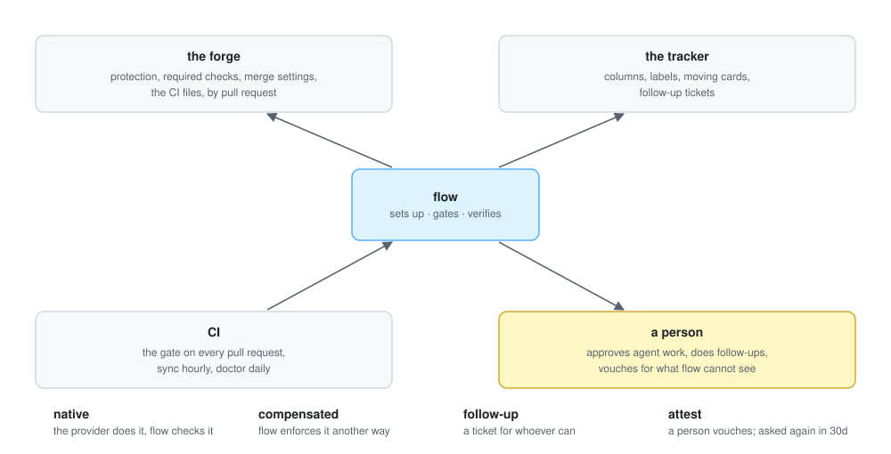
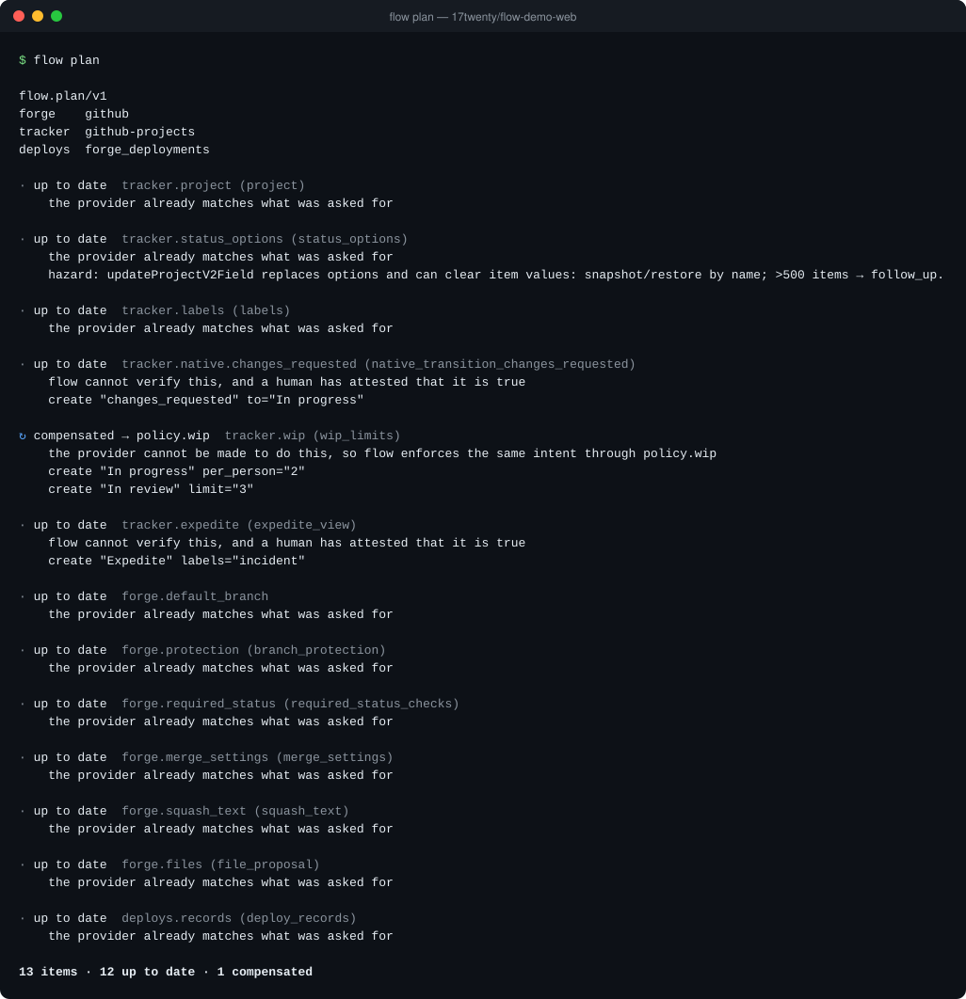
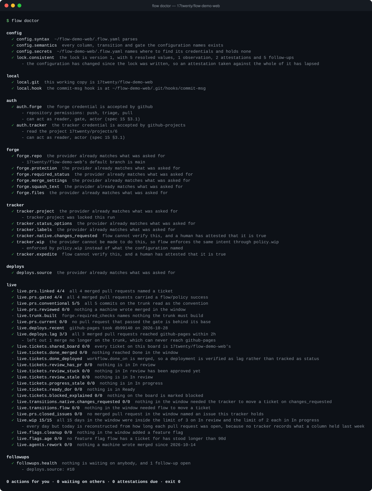

# How flow works

flow is set up once by a person and then runs in CI: on every pull request,
every hour, and once a day. This page shows that loop, how a ticket crosses the
board, and who does what — then what flow actually prints, captured from
[flow-demo-web](https://github.com/17twenty/flow-demo-web), a repository set up
from empty with `flow init`.

## The loop

```mermaid
flowchart LR
  init["flow init<br/><small>writes config + CI</small>"]
  fix["flow doctor --fix<br/><small>finds the board, owners</small>"]
  plan["flow plan<br/><small>what would change</small>"]
  apply["flow apply<br/><small>protection, columns, files</small>"]
  gate["flow check pr<br/><small>posts flow/policy</small>"]
  sync["flow sync<br/><small>hourly: cards move</small>"]
  doctor["flow doctor<br/><small>daily: setup + audit</small>"]
  person(["a person<br/><small>follow-ups and attestations</small>"])
  subgraph once["Once, by a person"]
    direction LR
    init --> fix --> plan --> apply
  end
  subgraph ci["From then on, in CI"]
    direction LR
    pr["pull request"] --> gate --> merge["merge"]
    merge --> sync --> deploy["deploy"] --> doctor
    doctor --> pr
  end
  apply -- "commit what init wrote through a pull request" --> pr
  doctor -- "the work it cannot do" --> person
```

**Set up.** `flow init` writes `.flow.yaml` and the CI workflow. `flow doctor
--fix` finds what it can — which board, who owns what — and asks for the rest.
`flow plan` says what would change and `flow apply` changes it: branch
protection, required checks, merge settings, the board's columns and labels.

**Gate.** Every pull request gets a `flow/policy` status from `flow check pr`,
with a comment explaining anything that warns or blocks
([why am I seeing this?](rules.md)).

**Keep it true.** `flow sync` moves the cards flow owns between runs, and the
daily `flow doctor` checks that the setup still holds and audits what actually
happened — every merge gated, linked, built and deployed in time, and the board
telling the truth.

## A ticket's way across the board

Each move belongs to somebody, and `.flow.yaml` says who: flow for the moves
that follow from what happens to pull requests, the tracker's own automation
where it already does the job. `flow doctor` checks that whoever owns a move
made it.

## Who does what

What flow asks of a provider ends one of four ways:

| | |
|---|---|
| native | the provider does it, and flow checks that it does |
| compensated | the provider cannot, so flow enforces the same intent itself — GitHub Projects has no column limits, so the gate holds the WIP limits |
| follow-up | flow cannot, so it files a ticket for whoever can, and closes it when it sees the work done |
| attest | flow cannot see it at all, so a person vouches for it, and is asked again in 30 days |

## What it prints

The gate on a pull request — here a `ci:` change, which needs no ticket:

`flow plan` on a repository flow has already set up — nothing to change, one
intent enforced another way:

The daily `flow doctor`, run as the bot account CI uses — every setup check
and every audit green:

The images are drawn by the scripts in [`img/tools/`](img/tools/) from the
captured output beside them; PNG copies sit next to each SVG for places that
cannot show SVG.
